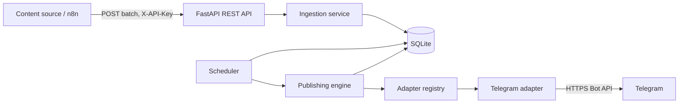
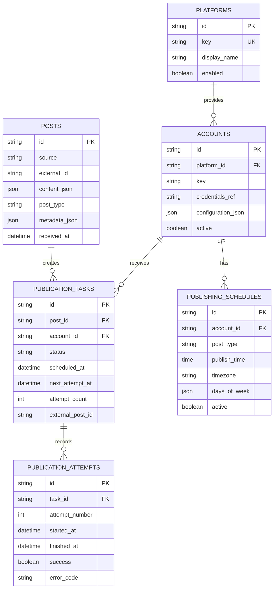

# Architecture — Universal Publishing Platform

## 1. Architectural overview

The publisher is a durable intermediary between content sources (initially n8n) and destination platforms (initially Telegram).



The database is the durable boundary. After successful ingestion, the publisher owns scheduling and delivery. n8n does not need to remain online.

## 2. Component responsibilities

| Component | Owns | Must not own |
|---|---|---|
| REST API | HTTP, authentication, schemas, status queries | Platform API calls or schedule calculations |
| Ingestion service | Idempotency, post persistence, target resolution, task creation | Platform-specific formatting |
| Publishing engine | Claiming tasks, invoking adapters, state transitions, retries | Platform-specific request/response details |
| Scheduler | Schedule matching, time-zone calculations, due-work wakeups | Platform API calls |
| Adapter registry | Resolving a platform key to an adapter | Business scheduling rules |
| Platform adapter | Platform validation, formatting, API calls, error mapping | Core database access or task scheduling |
| Persistence layer | Models, transactions, migrations | Platform-specific behavior |
| Secret provider | Resolving credential references | Persisting raw credentials in ordinary tables |

## 3. Data flow

### 3.1 Ingestion

1. n8n sends a batch to `POST /api/v1/posts`.
2. API authenticates `X-API-Key` and validates the batch envelope.
3. Ingestion service handles each post independently.
4. It checks `(source, external_id)`:
   - New key: validate targets and persist the original post.
   - Existing key with identical immutable data: return `duplicate`.
   - Existing key with different immutable data: return `conflict`.
5. For each valid target, create one `publication_tasks` row.
6. Commit accepted post and tasks before returning `accepted`.

### 3.2 Scheduling

1. Scheduler finds `pending` tasks without `scheduled_at`.
2. It matches `post_type` and account to an active schedule.
3. It calculates the next eligible local slot in the schedule's IANA time zone.
4. It converts the instant to UTC and stores `scheduled_at`; status becomes `scheduled`.
5. A scheduled task is not silently moved by ordinary scheduler runs.
6. If no schedule matches, task remains pending and is visible through the API.

### 3.3 Publishing

1. Engine finds due `scheduled` tasks and due `retry_wait` tasks.
2. It claims one task atomically and creates an attempt record.
3. It loads the original universal content, account configuration, and credentials.
4. It resolves the adapter through the registry.
5. Adapter validates/transforms content and calls the platform API.
6. Engine records success, retry, or permanent failure.
7. Each target task is processed independently.

## 4. Database relationships



Important uniqueness rules:
- `posts`: unique `(source, external_id)`.
- `accounts`: unique `(platform_id, key)`.
- `publication_tasks`: unique `(post_id, account_id)`.
- `publication_attempts`: unique `(task_id, attempt_number)`.
- Schedule-slot assignment must prevent two tasks from occupying the same account slot.

## 5. Core/adapter boundary

The core knows only:
- Universal content.
- Platform key.
- Account identity and generic configuration.
- Common adapter input/output types.
- Normalized error classifications.

The core must not know:
- Telegram chat IDs or Bot API method names.
- Telegram parse modes or response JSON.
- Platform-specific SDK classes.
- Platform-specific retry response structures.

All platform-specific behavior stays inside its adapter package.

## 6. Common adapter contract

The interface should be represented by a Python `Protocol` or abstract base class and typed shared models.

```python
class PlatformAdapter(Protocol):
    platform_key: str

    async def validate_account(self, account: AccountConfig) -> None:
        ...

    async def validate_content(
        self,
        content: UniversalContent,
        account: AccountConfig,
    ) -> None:
        ...

    async def publish(
        self,
        content: UniversalContent,
        account: AccountConfig,
    ) -> PublishResult:
        ...
```

Shared types:
- `UniversalContent`: platform-independent content.
- `AccountConfig`: account identifier, non-secret settings, and credentials resolved by the secret provider.
- `PublishResult`: external identifier and sanitized response metadata.
- `AdapterError`: stable code, safe message, classification (`temporary`, `rate_limited`, `permanent`), optional retry delay.

Adapters may use private helper classes and platform SDKs. They must not access core repositories or mutate database records directly. The publishing engine owns persistence and task transitions.

## 7. Suggested source layout

```text
publisher/
├── AGENTS.md
├── README.md
├── .env.example
├── Dockerfile
├── docker-compose.yml
├── alembic.ini
├── alembic/
│   └── versions/
├── docs/
│   ├── TECHNICAL_SPECIFICATION.md
│   └── ARCHITECTURE.md
├── src/
│   └── publisher/
│       ├── main.py
│       ├── api/
│       ├── core/
│       │   ├── config.py
│       │   ├── security.py
│       │   ├── content.py
│       │   ├── adapters.py
│       │   ├── publishing.py
│       │   └── scheduling.py
│       ├── db/
│       │   ├── models.py
│       │   ├── session.py
│       │   └── repositories/
│       ├── services/
│       │   ├── ingestion.py
│       │   └── accounts.py
│       └── adapters/
│           ├── registry.py
│           └── telegram/
│               ├── adapter.py
│               └── client.py
└── tests/
    ├── api/
    ├── core/
    ├── services/
    └── adapters/
```

This is a logical starting structure, not a requirement to create empty modules in advance. Keep modules cohesive and avoid unnecessary abstraction.

## 8. Transaction and reliability boundaries

- Ingestion persists the post and its valid target tasks in one transaction per item.
- Task claiming and attempt creation occur atomically.
- Adapter network calls occur outside long-running database transactions.
- Final attempt/task outcome is persisted in a new transaction.
- A stale `publishing` task is recovered after a configured timeout.
- A crash after the platform accepted a request but before local success was committed can cause an ambiguous outcome. The system must record this limitation and must not promise exactly-once delivery.

## 9. Deployment topology

The same application image runs in both environments:

```text
n8n container ── private Docker network ── publisher container
                                            │
                                            ├── /app/data (persistent volume)
                                            └── outbound HTTPS to platform APIs
```

The publisher's API port is configurable (default `8000`). Network names and volume host paths are deployment configuration, not application logic. In TrueNAS, configure the same image, environment variables, persistent mount, and network attachment through the Custom App interface.

## 10. Architectural change rule

Any change that introduces platform-specific logic into core modules, makes the publisher dependent on n8n at runtime, or changes the one-task-per-post/account model requires explicit approval before implementation. Update this document and the technical specification when an approved architectural change is made.
